<div align="center">

# 🔥 Pokémon FireRed — PT-BR (hack Cintra)

**FireRed em português do Brasil, com qualidade de vida dos jogos atuais, dia e noite, clima,<br>
a Pokédex inteira obtível e uma esteira de testes automática no emulador.**


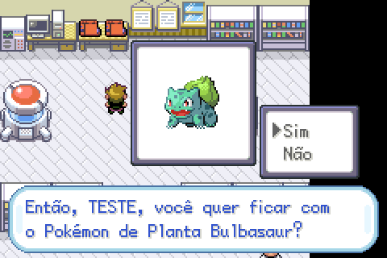
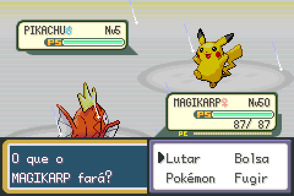
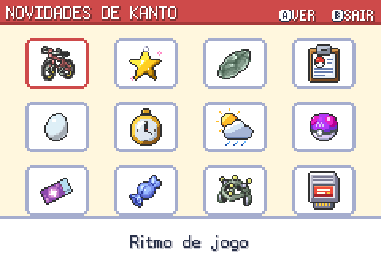

</div>

---

## Sumário

- [O que é](#o-que-é)
- [Destaques](#destaques)
- [Tudo o que mudou](#tudo-o-que-mudou)
- [Galeria](#galeria)
- [Linha do tempo](#linha-do-tempo)
- [Esteira de testes](#esteira-de-testes)
- [Como compilar](#como-compilar)
- [Onde fica cada coisa](#onde-fica-cada-coisa)
- [Créditos](#créditos)

## O que é

Uma hack pessoal de **Pokémon FireRed**, feita sobre a decompilação da
[pret](https://github.com/pret/pokefirered) (versão do Nintendo Switch Online, `pokefirered_switch.gba`).
O jogo inteiro foi traduzido para o português do Brasil e ganhou recursos dos jogos mais novos, sem
perder o jeito do FireRed.

> [!NOTE]
> Projeto feito para jogar, sem distribuição de ROM. Para compilar, você precisa da sua própria cópia
> do jogo (veja [Como compilar](#como-compilar)).

## Destaques

| | Recurso | Em uma frase |
|:-:|---|---|
| 🇧🇷 | **Tradução completa** | Textos, menus, nomes, Pokédex e ajuda em português do Brasil. |
| ⚡ | **Jogo mais rápido** | Andar e correr mais rápidos, texto instantâneo, batalhas mais ágeis. |
| ✨ | **Shiny mais comum** | 1 em 4096, e o Amuleto Brilhante dobra a chance. |
| 🔁 | **Fim das trocas** | Quem evoluía por troca evolui por nível (com o item, quando precisa). |
| 📋 | **Resumo turbinado** | Páginas EVOLUÇÃO (com amizade em corações) e IVs/EVs. |
| 🥚 | **Creche genética** | IVs, natureza e golpes de ovo passam dos pais, com itens de criação. |
| 🌗 | **Dia e noite** | Um dia dura uma hora; o céu muda de cor e os encontros mudam com a hora. |
| 🌦️ | **Clima** | Chuva, neve, areia, cinzas e sol forte por região, e visíveis na batalha. |
| 🧚 | **Tipos e golpes modernos** | Físico ou especial por golpe e o tipo Fada, como em Pokémon X e Y. |
| 📖 | **Pokédex completa** | Exclusivos do LeafGreen, os dois fósseis, lendários e míticos obtíveis. |
| 🛠️ | **Melhorias modernas** | Exp. Share para todos, PC Portátil, HMs sem ensinar, status com L/R… |
| 🏆 | **Conquistas e diário** | 41 conquistas com prêmio na bolsa e o diário das batalhas marcantes, no Cartão de Treinador. |
| 🔝 | **Revanches por degrau** | Depois do Hall da Fama, a Elite 4 e as revanches do Explorador VS sobem até o nível 100. |
| 🧭 | **DexNav** | Os Pokémon de cada lugar, com a chance real, o que falta capturar e onde achar cada um. |
| 🐾 | **Pokémon seguidor** | O 1º da equipe anda atrás de você no campo (por enquanto os iniciais de Kanto e a família do Pikachu). |
| 🗞️ | **Tela de novidades** | O Prof. Carvalho apresenta cada mudança em cartões ilustrados. |
| 🧪 | **Esteira de testes** | Toda ROM é jogada no emulador e testada antes de existir. |

## Tudo o que mudou

> A mesma lista aparece dentro do jogo, na **tela de novidades** do Prof. Carvalho.

<details open>
<summary><b>🌦️ Clima e batalha</b></summary>

| | |
|---|---|
| **Clima na batalha** | Chuva, granizo, areia e sol aparecem durante a batalha toda e somem enquanto um golpe é animado. Com Cloud Nine ou Air Lock em campo, a cena volta ao normal. |
| **Sol forte** | A Ilha Cinnabar e o Monte Ember têm dias de sol forte, com o efeito do Emerald: a tela clareia e pulsa. Na batalha, começa com sol. |
| **Clima por região** | Sorteado a cada período: chuva no litoral, neve na Ilha Quatro (que vira granizo na batalha), areia nas Rotas 3 e 10, cinzas e sol forte no vulcão. |
| **Status com L/R** | Na escolha da ação, **L** mostra os bônus e as quedas do seu Pokémon e **R** os do adversário (`Atq+2 Vel-1`…). |
| **Chefes mais espertos** | Líderes, Elite 4 e rival preparam o terreno no 1º turno e escolhem o golpe pelo PS de cada lado. |
| **Chefes com clima** | A Misty abre com Dança Chuva e o Blaine com Dia de Sol, com times montados para o clima. |
| **Barra de PS moderna** | Anda rápido mesmo com muito PS e muda de cor aos poucos, do verde ao vermelho. |

<p align="center">

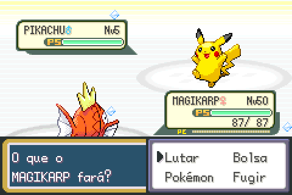

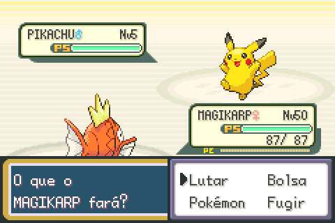
</p>
</details>

<details open>
<summary><b>🧚 Tipos e golpes</b></summary>

| | |
|---|---|
| **Físico ou especial por golpe** | Cada golpe é Físico, Especial ou de Estado, como desde a 4ª geração: Soco de Fogo usa o Ataque, e Thick Fat e queimadura seguem a categoria. No resumo, o detalhe do golpe mostra **FÍSICO**, **ESPEC.** ou **ESTADO** ao lado do PODER. |
| **Tipo Fada** | A tabela de tipos de Pokémon X e Y: Fada vence Dragão, Lutador e Sombrio e é imune a Dragão; Aço não resiste mais a Fantasma e Sombrio. 18 espécies viraram Fada (Clefairy, Jigglypuff, Togepi, Marill, Ralts, Mawile…), e Encantar, Beijo Doce e Luar também. |
| **Seis golpes de Fada** | Expl. Lunar, Jogo Duro, Clarão Desl., Beijo Dren., Vento Fada e Voz Desarm., com os dados de X e Y, nos níveis de X e Y. O Poder Oculto dos seus Pokémon não muda. |

<p align="center">
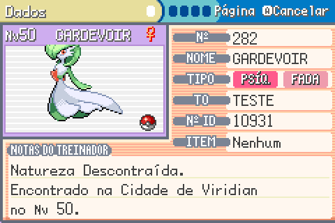
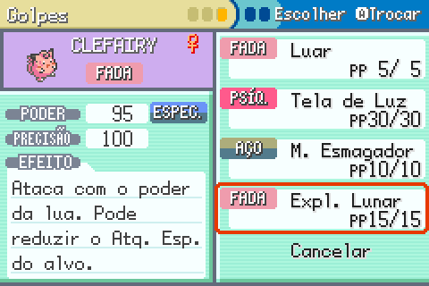
</p>
</details>

<details open>
<summary><b>🏆 Conquistas e diário</b></summary>

| | |
|---|---|
| **Conquistas** | 41 conquistas em 5 abas (História, Batalha, Captura, Treino e Exploração): as 8 insígnias, Elite 4 e Campeão, treinadores vencidos de 10 em 10, shinies, lendários, Pokédex, nível 100, ovo perfeito, ₽999.999, horas de jogo… Cada linha mostra ✓ ou o progresso (`87/100`), e o rodapé, o total da aba. |
| **Prêmio na hora** | Ao conquistar, o jogo pausa com um aviso animado e a fanfarra, e o prêmio cai na bolsa (bolsa cheia: no PC). Prêmios maiores para as conquistas mais difíceis, até a Master Ball. |
| **Save antigo reconhecido** | Na primeira vez que um save de antes abre nesta versão, o jogo confere o que já foi feito e entrega tudo num aviso só. O que não dá mais para provar (vencer um líder com um Pokémon só, vencer o rival em todas) fica riscado e fora do total. |
| **Diário da jornada** | A primeira vitória contra cada líder, o rival, a Elite 4 e o Campeão, e cada lendário capturado ou derrotado: tempo de jogo, turnos, time usado e o MVP (quem mais nocauteou). |
| **Onde fica** | No Cartão de Treinador (menu START), o **SELECT** abre as conquistas; na tela, **L/R** trocam a aba e o **SELECT** alterna para o diário. |

<p align="center">
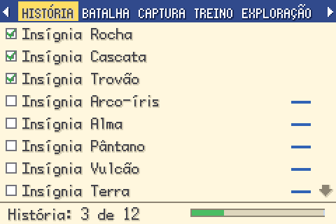
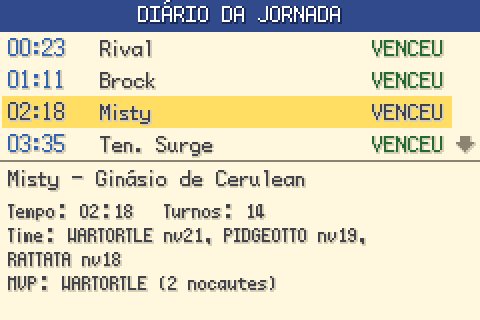
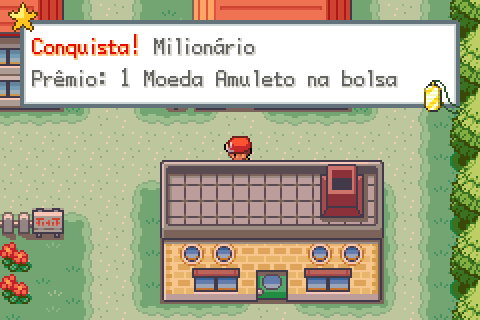
</p>
</details>

<details open>
<summary><b>🔝 Revanches por degrau</b></summary>

| | |
|---|---|
| **A guarda da Liga pergunta** | Depois do Hall da Fama, a guarda na porta da Elite 4 (Platô Índigo) pergunta o nível das batalhas a cada visita: **Normal** (o jogo de sempre) ou **Nível 60, 70, 80, 90 e 100**, em escolha livre. Enquanto a Lorelei está ausente (a Liga fecha até o fim das Ilhas Sevii), a escolha vale só para o Explorador VS. |
| **Para quem vale** | Elite 4, Campeão e todas as revanches do **Explorador VS**. O primeiro combate de cada treinador não muda. |
| **Times mais fortes** | 6 Pokémon em volta do nível escolhido (o ás um pouco acima), espécies evoluídas e mais fortes do tema de cada classe, inclusive de Johto e Hoenn, com item segurado e IVs que sobem com o degrau (até 31). A Elite 4 e o Campeão têm times feitos à mão para cada degrau. |
| **IA dos chefes** | Do Nível 80 para cima, as revanches do Explorador VS usam a IA dos líderes e da Elite 4. |
| **Conquistas** | Vencer uma revanche no Nível 100 e a Liga no Nível 100 são duas das 41 conquistas. |

<p align="center">
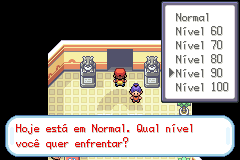
</p>
</details>

<details open>
<summary><b>🧭 DexNav</b></summary>

| | |
|---|---|
| **Como abrir** | Linha **DEXNAV** no menu START, logo abaixo da Pokédex. O item-chave DexNav (já vem na bolsa, e um save antigo ganha ao CONTINUAR) também abre pela bolsa e pode ser registrado no **SELECT**. |
| **O mapa de agora** | Os Pokémon do lugar em abas por jeito de encontrar (**GRAMA**, **SURFAR**, **VARAS** com as três varas e **PEDRA**, do Esmaga Pedra; **L/R** trocam a aba): ícone, ● capturado, ◐ visto ou ? nunca visto (silhueta e "??????"), a chance de aparecer e os níveis, em colunas alinhadas. A chance é a de verdade: horário, metade LeafGreen e Caverna Mutante incluídos. |
| **Progresso** | O topo mostra quantas espécies do mapa você já capturou (`1/4`), contando todos os horários; a lista mostra as de agora e uma linha "+N à noite" (ou de dia, de manhã) para as que só aparecem em outro horário. Aba completa ganha coroa; mapa completo, **100%** com coroa. |
| **SELECT mapas** | Todos os 124 mapas com encontro (um por andar), de Kanto e das Ilhas Sevii (**L/R**), com barra de progresso e o total de mapas completos. **A** abre qualquer mapa já visitado; o que você ainda não visitou fica como `?/?`. |
| **START busca** | Escolha um Pokémon que você já viu e veja onde ele aparece, com jeito, chance e horário (primeiro os que aparecem agora; os de outro horário em cinza, com a chance do horário em que ele mais aparece). **A** abre o mapa visitado na aba do jeito, já na linha dele se ele aparece agora (senão ele está na linha "+N"). |

<p align="center">
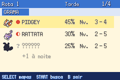
</p>
</details>

<details open>
<summary><b>🐾 Pokémon seguidor</b></summary>

| | |
|---|---|
| **Quem segue** | O 1º da equipe, se for uma das 12 espécies desta etapa: Bulbasaur, Charmander e Squirtle com as evoluções, Pichu, Pikachu e Raichu (sprites de HeartGold/SoulSilver, com a versão shiny). Outro Pokémon no 1º lugar, desmaiado ou Ovo: ninguém segue. |
| **No campo** | Anda e corre no mesmo ritmo do jogador, pula ledges junto, atravessa portas e bordas de mapa, entra na grama alta e mexe as patas parado. Não bloqueia nada: voltar para o tile dele troca os dois de lugar, NPCs passam por ele e o **A** nele não faz nada. Pega o tom do dia e da noite e o clima. |
| **Some e volta** | Some na bicicleta, no Surf, no Voar, na Corda de Fuga, no Cavar, no Teleporte e no Doce Aroma, e volta logo depois, atrás de você. Trocar o 1º (menu da equipe, PC, troca, evolução, cura no Centro) troca o seguidor. |
| **Opção** | Linha **Seguidor** (Sim/Não) nas OPÇÕES do menu START. O seguidor não vai para o save: ao CONTINUAR, ele é recriado. |

<p align="center">
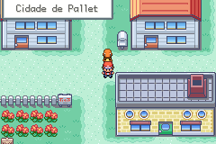
</p>
</details>

<details>
<summary><b>🛠️ Melhorias modernas</b></summary>

| | |
|---|---|
| **Repelente automático** | Quando o efeito acaba, o jogo pergunta se você quer usar outro. |
| **PE ao capturar** | Capturar dá PE à equipe, como se o Pokémon tivesse sido derrotado. |
| **PE para a equipe toda** | Quem lutou ganha tudo e o resto ganha metade, sem item. O assistente da Rota 15 dá o Ovo da Sorte. |
| **PC Portátil** | Já vem nos Itens-chave e abre o PC de qualquer lugar (menos ginásios e Liga). Dá para registrar no SELECT. |
| **Incubadora** | Dada pelo dono da creche da Ilha Quatro: Ovos chocam 2× mais rápido (4× com Corpo Chama ou Armadura Magma). |
| **HMs sem ensinar** | Com a insígnia e a HM na bolsa, basta um Pokémon que possa aprender o golpe. Cavernas escuras já acendem. |
| **Viagem pelo Mapa** | Com o Voar liberado, o Mapa da Cidade leva direto a uma cidade visitada. |
| **Chefes mais espertos** | Líderes, Elite 4, rival e as revanches do Nível 80 para cima trocam de Pokémon antes do seu golpe super efetivo (lembrando dos golpes que você já mostrou), escolhem melhor quem entra e usam poções e curas de estado na hora certa, sem repetir uma cura que você desfez. Treinadores comuns não mudam. |
</details>

<details>
<summary><b>⚡ Ritmo, shiny e evoluções</b></summary>

- **Andar e correr mais rápido**; os eventos da história seguem no ritmo normal.
- **Texto instantâneo** com a velocidade Rápida, que é o novo padrão.
- **Batalhas mais ágeis**: pausas mais curtas e barras de PS e PE mais rápidas.
- **Shiny 1/4096** para selvagens e ovos; o **Amuleto Brilhante** vem do Prof. Carvalho depois dos 151 de Kanto.
- **Fim das trocas**, no nível 37:
  - direto: Kadabra → Alakazam, Machoke → Machamp, Graveler → Golem, Haunter → Gengar;
  - segurando o item (que não é gasto): Onix → Steelix e Scyther → Scizor (Revestimento Metálico), Seadra → Kingdra (Escama de Dragão), Porygon → Porygon2 (Melhora), Clamperl → Huntail/Gorebyss, Slowpoke → Slowking e Poliwhirl → Politoed (Pedra do Rei).
- **Itens de evolução à venda** no 4º andar da Loja de Celadon, inclusive a Pedra Solar.
- **Espeon e Umbreon**: Eevee com amizade 220+ evolui de dia (Espeon) ou no entardecer e à noite (Umbreon).
- **Milotic**: Feebas evolui segurando a Escama Prisma (loja da Ilha Quatro).

<p align="center">
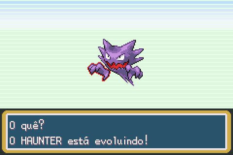
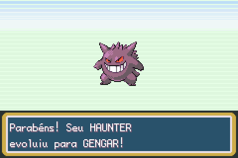
</p>
</details>

<details>
<summary><b>📋 Resumo do Pokémon e creche</b></summary>

- **Página EVOLUÇÃO**: como cada Pokémon evolui (nível, pedra, item, troca ou amizade).
- **Amizade em corações**, com o número (até 255) e a marca 220+.
- **Página IVs/EVs**: nota de cada IV (de Fraco a Perfeito), total em %, EVs e tipo do Poder Oculto.
- **Herança de IVs**: o ovo segue a média dos pais, com variação e mutações raras.
- **Natureza e golpes de ovo** herdados dos pais.
- **Itens de criação** na Ilha Quatro: Pedra Eterna, Nó do Destino e os itens de Poder.

<p align="center">
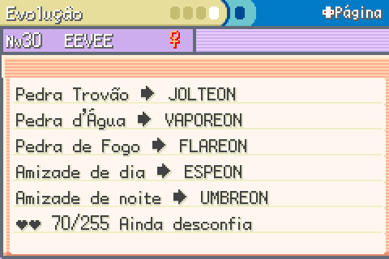
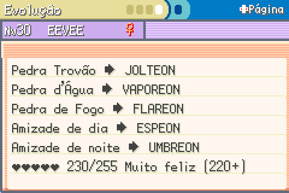
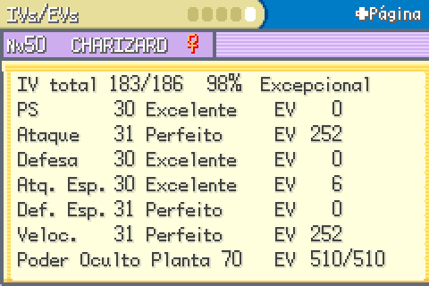
</p>
</details>

<details>
<summary><b>🌗 Dia e noite</b></summary>

- **Um dia do jogo dura uma hora**: manhã (04h–10h), tarde (10h–17h), entardecer (17h–20h) e noite (20h–04h).
- **Hora no menu START**, cor do céu por período e um aviso quando o período vira.
- **Encontros por horário**: à noite aparecem Hoothoot e outros notívagos.

<p align="center">
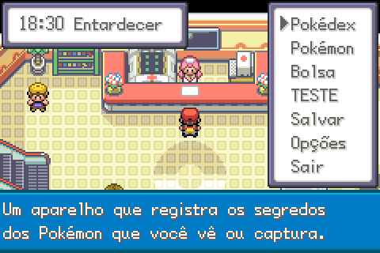
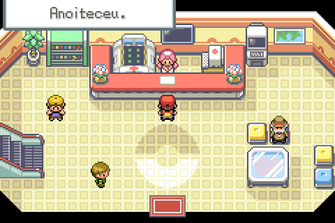
</p>
</details>

<details>
<summary><b>📖 Pokédex, lendários e pós-Liga</b></summary>

- **Pokédex Nacional desde o início.**
- **Exclusivos do LeafGreen** aparecem nos mesmos lugares do FireRed, dividindo a vez.
- **Iniciais na Zona de Safári**, raros: Bulbasaur no Leste, Charmander no Norte, Squirtle no Oeste (surfando).
- **Caverna Mutante** muda de Pokémon a cada dia.
- **Os dois fósseis** do Monte Lua (Domo e Hélice).
- **Bilhetes do Carvalho**: Bilhete Místico (Lugia e Ho-Oh) e Bilhete Aurora (Deoxys) no primeiro Hall da Fama.
- **Cães em sequência**: Entei, Raikou e Suicune, um depois do outro.
- **Segunda chance**: lendário derrotado volta na próxima entrada no Hall da Fama.
- **Míticos**: Mew, Celebi e Jirachi escondidos pelo mundo, com pistas.
- **Presentes do Carvalho**: um ovo raro por vitória na Liga (Larvitar, Bagon, Beldum) e ¥45.000 na primeira.

<p align="center">
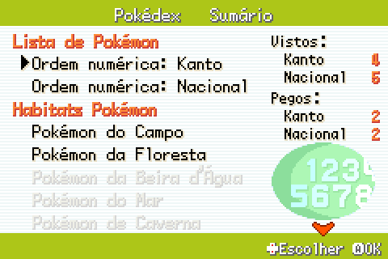
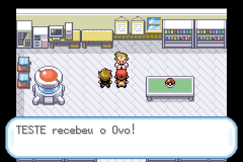
</p>
</details>

<details>
<summary><b>🇧🇷 Sobre a hack</b></summary>

- **Tudo em português do Brasil**: textos, menus, nomes, Pokédex e sistema de ajuda, com glossário próprio e medição de largura de cada janela.
- **Save em qualquer emulador de GBA.**
- **Tela de novidades**: o Prof. Carvalho mostra cada mudança num cartão com ícone, antes e depois.
</details>

## Galeria

| | | |
|:-:|:-:|:-:|
| 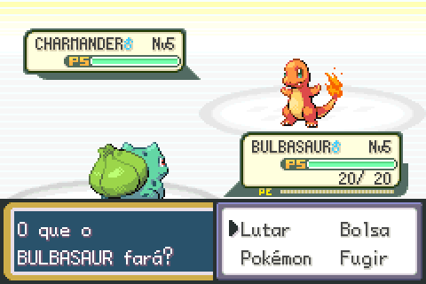<br>Batalha com o rival | 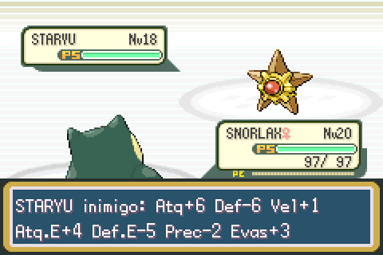<br>Status com **R** (7 alterações) | 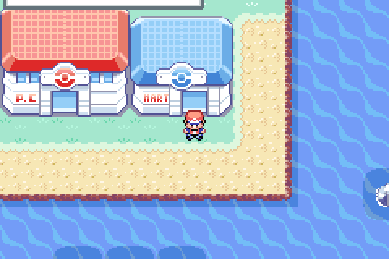<br>Sol forte em Cinnabar |
| 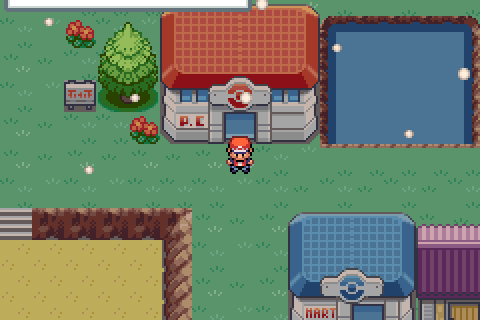<br>Neve na Ilha Quatro | 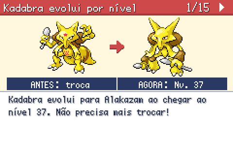<br>Cartão de novidade | 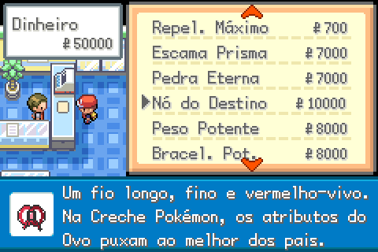<br>Itens de criação |
| 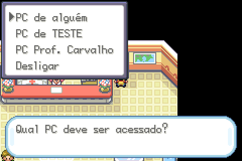<br>PC | <br>Escolha do inicial | <br>Sol na batalha |
| <br>Gardevoir agora é **Fada** | 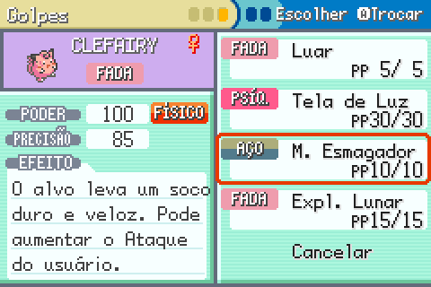<br>Categoria do golpe: **FÍSICO** | <br>Golpe novo: **Expl. Lunar** |

## Linha do tempo

| Etapa | O que trouxe |
|---|---|
| **Hack 1** | Build do Switch jogável num GBA comum (save na flash). |
| **Hack 2** | Shiny 1/4096 + Amuleto Brilhante; jogo mais rápido. |
| **Hack 3** | Fim das evoluções por troca. |
| **Hacks 4 e 5** | Páginas EVOLUÇÃO e IVs/EVs no resumo. |
| **Hack 6** | Creche genética. |
| **Hack 7** | Dia e noite, clima por região, encontros por horário. |
| **Tradução** | O jogo inteiro em PT-BR, em três rodadas. |
| **Hack 8** | Pokédex completa: LeafGreen, fósseis, lendários e míticos. |
| **Novidades** | Tela do Prof. Carvalho com os cartões. |
| **Melhorias modernas** | Repelente, PE, IA, barra de PS, PC Portátil, Incubadora, HMs, viagem, status com L/R, chefes com clima. |
| **Clima na batalha** | Clima sempre visível e o sol forte consertado. |
| **Físico/especial e Fada** (30/10) | Categoria por golpe, tipo Fada com a tabela de X e Y, 18 espécies e 6 golpes novos. |
| **Conquistas e diário** (31/10) | 41 conquistas com prêmio e aviso, save antigo reconhecido e o diário das batalhas marcantes. |
| **Revanches por degrau** (31/10) | A guarda da Liga escolhe o nível (Normal a 100) da Elite 4, do Campeão e das revanches do Explorador VS: times de 6, item, IVs altos e a IA dos chefes. |
| **Chefes mais espertos** (31/10) | Os chefes trocam antes do golpe super efetivo, escolhem melhor quem entra e usam poções e curas na hora certa; treinador comum igual. |
| **DexNav** (01/11) | Os Pokémon de cada mapa por jeito de encontrar, com a chance real, marcas da Pokédex e progresso; a lista dos 124 mapas e a busca por Pokémon. No menu START e no SELECT. |
| **Pokémon seguidor** (02/11) | O 1º da equipe anda atrás do jogador (12 espécies, normal e shiny), no ritmo dele, sem bloquear ninguém; some na bicicleta, no Surf e nos golpes de campo e volta depois; opção Seguidor nas OPÇÕES. |

## Esteira de testes

Nenhuma ROM existe sem passar pela esteira. O `make firered_switch` compila, joga o começo do jogo
sozinho no emulador e só versiona a ROM em `roms/<N>.0/` se tudo der certo.

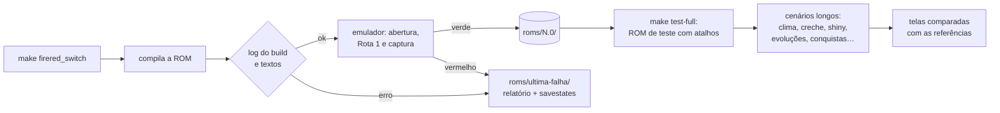

- **Dois modos**: o rápido (~40 s) roda em todo build; o completo (~4 min) roda dezenas de cenários
  numa ROM de teste com atalhos (dar item, mudar o relógio, abrir batalha, ler a RAM).
- **Rodízio de iniciais**: cada execução joga com Bulbasaur, Charmander ou Squirtle, e as telas são
  comparadas pixel a pixel com as referências aprovadas de cada um.
- **Checagem de texto**: mede a largura de cada frase traduzida na janela onde ela aparece e o
  tamanho dos buffers, para nada estourar.
- **4834 testes em pytest** cobrem a própria esteira e as regras de cada hack.

<details>
<summary>Comandos (WSL)</summary>

```bash
make firered_switch          # ROM testada e versionada
make test-quick              # retesta sem versionar
make test-full               # tudo, com a ROM de teste
make test-watch              # assiste numa janela
python3 -m pytest test -q    # testes da esteira
```

O manual completo está em [`test/README.md`](test/README.md).
</details>

## Como compilar

1. Prepare o ambiente da pret (WSL + `agbcc`) seguindo o [INSTALL.md](INSTALL.md).
2. Na raiz do repositório, no WSL:

   ```bash
   make firered_switch
   ```

3. A ROM testada sai em `roms/<N>.0/pokefirered_switch.gba`. Se a esteira reprovar, o relatório fica
   em `roms/ultima-falha/relatorio.html`.

> [!TIP]
> `SKIP_TESTS=1 make firered_switch` gera a ROM sem a esteira (ela sai marcada como não testada).

## Onde fica cada coisa

| Caminho | O quê |
|---|---|
| `src/battle_weather_visual.c` | Clima sempre visível na batalha |
| `src/field_weather.c` | Clima do campo, inclusive o sol forte restaurado |
| `src/day_night.c`, `src/data/day_night_weather.h` | Relógio, períodos e sorteio de clima por região |
| `src/data/novidades/cartoes.json` | Cartões da tela de novidades |
| `src/field_move_rules.c` | HMs sem ensinar |
| `src/follower.c`, `tools/seguidores/` | Pokémon seguidor e o conversor dos sprites |
| `test/esteira/` | A esteira de testes (Python + mGBA) |
| `test/referencias/` | Telas aprovadas, por inicial |
| `roms/` | ROMs testadas e versionadas |

## Créditos

- **[pret](https://github.com/pret/pokefirered)**: a decompilação do FireRed que é a base de tudo
  ([pret.github.io](https://pret.github.io/)).
- **[pret/pokeemerald](https://github.com/pret/pokeemerald)**: as tabelas de cor do sol forte.
- **Pokémon** é marca da Nintendo, Creatures Inc. e GAME FREAK inc. Este é um projeto de fã, sem fins
  comerciais.

<details>
<summary>ROMs que a decompilação original reproduz byte a byte</summary>

* [**pokefirered.gba**](https://datomatic.no-intro.org/?page=show_record&s=23&n=1616) `sha1: 41cb23d8dccc8ebd7c649cd8fbb58eeace6e2fdc`
* [**pokeleafgreen.gba**](https://datomatic.no-intro.org/?page=show_record&s=23&n=1617) `sha1: 574fa542ffebb14be69902d1d36f1ec0a4afd71e`
* [**pokefirered_rev1.gba**](https://datomatic.no-intro.org/?page=show_record&s=23&n=1672) `sha1: dd5945db9b930750cb39d00c84da8571feebf417`
* [**pokeleafgreen_rev1.gba**](https://datomatic.no-intro.org/index.php?page=show_record&s=23&n=1668) `sha1: 7862c67bdecbe21d1d69ce082ce34327e1c6ed5e`
* [**pokefirered_switch.gba**](https://datomatic.no-intro.org/index.php?page=show_record&s=23&n=x550) `sha1: baa452d0b24629dd7782cfc07a8984085dde1311`
* [**pokeleafgreen_switch.gba**](https://datomatic.no-intro.org/index.php?page=show_record&s=23&n=x551) `sha1: 62b9fc77549dbc67032eb6cbd0ea6ad3b825690f`
</details>
